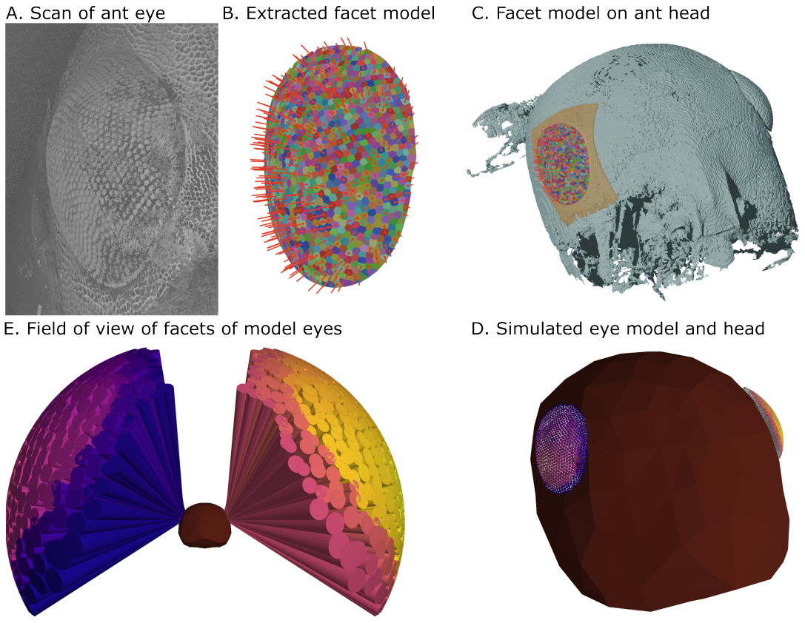

# scan-to-oces-pipeline
  
*The process of converting a scan to a 3D OCES-compliant model, as seen in figure 2 of the paper.*

This is a repository that stores the tools and instructions to convert an x-ray microtomography scan of an insect head/eye to an OCES-compliant glTF file, and is the 

The majority of large files are stored within [ORDA](NEEDS LINK)
